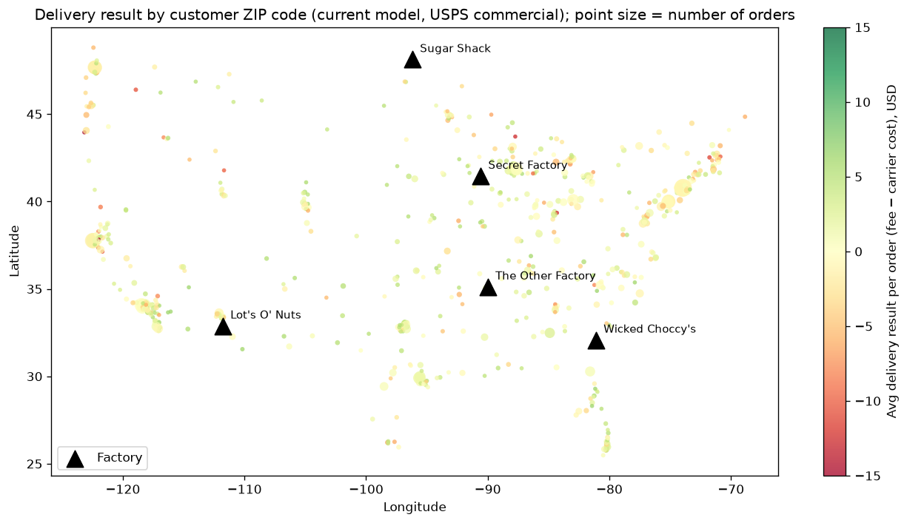
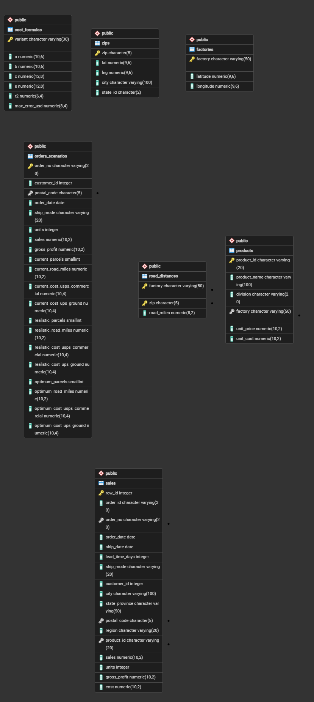

# Candy Logistics – Where Does Delivery Eat the Margin?

Portfolio project (Python · SQL · PostgreSQL) based on the **US Candy Distributor** dataset from [Maven Analytics](https://mavenanalytics.io/data-playground).
🇵🇱 Polska wersja: [README_PL.md](README_PL.md) · Project charter: [EN](docs/project_charter.md) / [PL](docs/karta_projektu.md)

## Business result in 30 seconds

- The company does **not** lose money on long distances – it loses on **split shipments**. One in three orders contains products
  from 2–4 factories and ships as several parcels for a single delivery fee: **−$3.2k per year** on delivery.
- If both chocolate factories made all five chocolate bars and every order shipped from the nearer one, shipping cost would fall by **31%**
  and profit would grow by **~$5.6k per year (+24% of gross profit)**. Margin after delivery: **43.5% → 54.1%**.
- Low-risk first step: serve the **western states entirely from the Arizona factory** – about **$1.9k per year**, California alone $1.2k.

*Dollar amounts are illustrative (carrier prices come from a fitted formula, the delivery fee is an assumption); proportions and directions are reliable.*



## Business problem

Every product is made in one fixed factory (five factories, 15 products), while customers order from all over the US.
The data has no shipping costs, so the project builds a shipping cost model and asks:

1. What is the margin after delivery today, and where does the company lose money on delivery?
2. Which factory → customer routes are the most and least efficient?
3. Which product lines have the best margin, before and after delivery?
4. Which product lines should be moved to a different factory?
5. How much would the margin grow if orders shipped from a closer factory?
6. Which levers add the most profit per year?

## Approach

| Step | What was done | Notebook / file |
|---|---|---|
| Data review and cleaning | Ship dates shifted by a constant 2,000 days corrected; 200 Canadian order lines excluded (no coordinates); 9,994 order lines, **5,009 orders**, 2021–2024 | `01`, `02` |
| Road distances | OpenRouteService Matrix API, **`driving-hgv` (truck) profile**, 5 factories × 631 ZIP codes = 3,155 routes; validated (road / straight-line ratio 1.05–1.60, median 1.19) | `03` |
| Shipping cost model | Parcel = order × factory; weight 2 oz per unit + 0.5 lb packaging; carrier price = a + b·weight + c·miles + e·weight·miles, fitted to **USPS Ground Advantage commercial** (R² 0.98) and **UPS Ground** (R² 0.92) rate tables | `04` |
| Delivery fee and margin | Customer pays a flat fee per order = today's average shipping cost ($14.28 USPS / $20.94 UPS); margin after delivery = gross profit + fee − carrier cost | `04` |
| Scenarios | **current** (fixed factory per product), **realistic** (nearest factory of the same division), **optimum** (nearest of all five), **product relocation** (greedy simulation, one factory per product) | `04`, `06` |
| Database | PostgreSQL schema with primary and foreign keys, validation queries, analysis view (order × scenario) | `05`, `sql/` |
| Profit analysis | Delivery losses, product line margins, route efficiency, relocation, levers ranked by profit per year | `06`, `sql/03_analysis.sql` |

Every finding in the notebooks has a **sanity check** – an attempt to disprove it with the data or common sense.
Two early assumptions were disproved this way (see the problem register).

## Key findings

**Q1 – Where the company loses money.** Split shipments: orders with 2+ parcels lose $3,211 per year on delivery
(margin after delivery 38% / 31% vs 49% for single-parcel orders). Distance alone rarely makes delivery unprofitable:
among single-parcel orders delivery earns money at every distance (margin 55% under 500 mi → 44% over 2,000 mi).
Small orders are not the problem – their margin after delivery (42–45%) equals that of large orders.

**Q2 – Routes.** The most efficient routes serve customers near the right factory (Arizona → CA, CO, OR; Georgia → VA): 37–43% of sales goes to the carrier.
The least efficient run coast to coast (Georgia → CA, WA; Arizona → FL, NJ, MA): 61–68%. The most expensive route is
**Georgia → California ($1.9k per year)**, although the other chocolate factory is in neighbouring Arizona. **47% of all miles driven are excess miles.**

**Q3 – Product lines.** Chocolate brings 93% of sales and 96% of profit after delivery. The two Georgia bars are the weakest after delivery
(Milk Chocolate 39.9%, Triple Dazzle Caramel 42.8% vs ~47% for the Arizona bars). Kazookles has a 7.7% gross margin and is negative after delivery – a pricing issue.

**Q4 – Relocation.** Best single move: Milk Chocolate to Arizona (+$1.1k per year); with Triple Dazzle Caramel +$3.5k. The full greedy plan puts all
chocolate in Arizona (+$3.9k per year) but needs +80% capacity there and leaves the Georgia factory idle.

**Q5–Q6 – Levers ranked by profit per year (USPS commercial):**

| Lever | Profit per year | % of gross profit | Requires |
|---|---|---|---|
| **Realistic:** both chocolate factories make all bars, ship from the nearer one | **+$5,553** | **+24%** | new lines in both factories (Georgia +53% volume) |
| Product relocation: all chocolate in Arizona | +$3,930 | +17% | +80% capacity in Arizona |
| Optimum: nearest of all five factories (ceiling) | +$6,474 | +28% | every factory makes everything |

With UPS Ground rates the savings are higher (realistic +$7,213 per year); the ranking is the same.
About half of every saving comes from **fewer parcels** and half from **shorter routes**.

## Recommendations

1. **Make all five chocolate bars in both chocolate factories and ship each order from the nearer one** (realistic scenario):
   +$5.6k per year, +24% of gross profit, margin after delivery 43.5% → 54.1%.
2. **Start with a pilot in the West:** the Arizona factory also makes the two Georgia bars for western customers (~$1.9k per year, a third of the potential).
3. **Fallback if new lines in both factories are not feasible:** move Milk Chocolate and Triple Dazzle Caramel to Arizona (+$3.5k per year).
4. **Verify production capacity and investment cost before rollout** – the savings must be weighed against them (not in the data).
5. **Review the price of Kazookles** (7.7% gross margin) and Wonka Gum.
6. **Keep the delivery fee as it is for small orders** – they are profitable; the problem is the number of parcels, not order size.

## Problem register

| # | Problem | Evidence in the data | Proposed solution | Impact |
|---|---|---|---|---|
| 1 | Split shipments | 1/3 of orders ship as 2–4 parcels for one fee; −$3.2k per year on delivery | Both chocolate factories make all bars (realistic) | +$5.6k per year |
| 2 | Coast-to-coast routes | 47% of miles are excess; Georgia → California costs $1.9k per year | Serve the West from Arizona (pilot) | ~+$1.9k per year |
| 3 | Cross-subsidy between customers | 35% of orders cost more to ship than the fee | Solved mostly by #1 (falls to 5%); zone-based fee as a fairness option (profit-neutral) | – |
| 4 | Low-margin products | Kazookles 7.7% gross margin, negative after delivery | Price review | small |
| 5 | Unknown production capacity | Realistic scenario: Georgia +53% volume | Verify capacity before rollout | risk control |
| 6 | Express shipments travel far | Same Day orders travel ~1,400 mi on average, like Standard | Review the express offer; price express separately | not quantified |
| 7 | Logistics hubs | The whole company ships ~2,700 lb per year vs ~40,000 lb in one full truckload | Not viable at current scale; revisit if volume grows many times | – |
| 8 | Data: `order_id` ≠ order | `order_id` = order + product code; 5,009 real orders, not 8,389 | Parcel = order × factory (model v2) | savings were underestimated (7–12% → 31%) |
| 9 | Data: wrong business assumption | "Company pays all shipping" made 60–80% of parcels loss-making | Customer delivery fee model | realistic model |

## Limitations

- Carrier prices come from a formula fitted to public rate tables; surcharges (fuel, residential) and express pricing are not included.
- The customer delivery fee is an assumption – the data does not say who pays for shipping. Dollar savings do not depend on the fee level; margin percentages do.
- No data on production capacity, production costs by factory or investment costs.
- Synthetic data: every customer ordered exactly once; the Sugar division has only 137 units in four years.
- Unit weight (2 oz) is the same for all products.

## Repository structure

```
candy-logistics/
├── data/
│   ├── raw/                  original CSV files (Maven Analytics)
│   └── processed/            cleaned tables, road distances, cost formulas, orders × scenarios
├── docs/                     project charter (EN / PL)
├── images/                   ERD, delivery map
├── notebooks/
│   ├── 01_data_review.ipynb
│   ├── 02_data_cleaning.ipynb
│   ├── 03_road_distances.ipynb
│   ├── 04_cost_model.ipynb
│   ├── 05_load_database.ipynb
│   └── 06_profit_analysis.ipynb
└── sql/
    ├── 01_create_tables.sql  schema with primary and foreign keys
    ├── 02_validation.sql     data checks after loading
    └── 03_analysis.sql       analysis view and business questions
```



## How to reproduce

1. Python 3 with `pandas`, `numpy`, `matplotlib`, `requests`, `sqlalchemy`, `psycopg2-binary`, `python-dotenv`; PostgreSQL.
2. Create a `.env` file (not in the repo) with `DB_USER`, `DB_PASSWORD`, `DB_HOST`, `DB_PORT`, `DB_NAME` and `ORS_API_KEY` (free key from OpenRouteService; needed only to re-run notebook 03 – the distances are already in `data/processed/`).
3. Run notebooks `01`–`04` in order.
4. Create the database with `sql/01_create_tables.sql`, load it with notebook `05`, check it with `sql/02_validation.sql`.
5. Run notebook `06` and `sql/03_analysis.sql`.

## Tools

Python (pandas, NumPy, matplotlib), PostgreSQL + pgAdmin, OpenRouteService API, Git/GitHub, VS Code (Jupyter). Power BI dashboard – next step.

---
Author: Mateusz ([MW-12](https://github.com/MW-12)) – aspiring Junior Data Analyst with a background in international freight forwarding (FTL/LTL).
