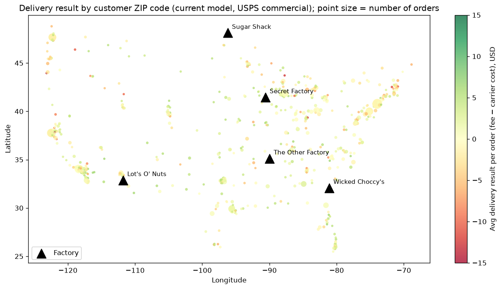
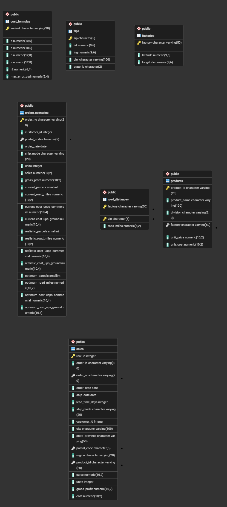

# Candy Logistics – gdzie dostawa zjada marżę?

Projekt portfolio (Python · SQL · PostgreSQL) na zbiorze **US Candy Distributor** z [Maven Analytics](https://mavenanalytics.io/data-playground).
🇬🇧 English version: [README.md](README.md) · Karta Projektu: [PL](docs/karta_projektu.md) / [EN](docs/project_charter.md)

## Wynik biznesowy w 30 sekund

- Firma **nie** traci na dalekich trasach – traci na **rozbitych wysyłkach**. Co trzecie zamówienie zawiera produkty
  z 2–4 fabryk i jedzie w kilku paczkach za jedną opłatą za dostawę: **−3,2 tys. $ rocznie** na dostawie.
- Gdyby obie fabryki czekolady produkowały wszystkie pięć batonów, a każde zamówienie wyjeżdżało z bliższej, koszt wysyłki spadłby o **31%**,
  a zysk wzrósłby o **ok. 5,6 tys. $ rocznie (+24% zysku brutto)**. Marża po dostawie: **43,5% → 54,1%**.
- Pierwszy krok o niskim ryzyku: **stany zachodnie obsługiwane w całości z fabryki w Arizonie** – ok. **1,9 tys. $ rocznie**, sama Kalifornia 1,2 tys. $.

*Kwoty w USD są poglądowe (ceny przewoźników pochodzą z dopasowanego wzoru, opłata za dostawę to założenie); wiarygodne są proporcje i kierunki.*



## Problem biznesowy

Każdy produkt powstaje w jednej, stałej fabryce (pięć fabryk, 15 produktów), a klienci zamawiają z całych Stanów.
W danych nie ma kosztów wysyłki, dlatego projekt buduje model kosztów i pyta:

1. Jaka jest dziś marża po dostawie i gdzie firma dokłada do dostawy?
2. Które trasy fabryka → klient są najbardziej, a które najmniej efektywne?
3. Które linie produktowe mają najlepszą marżę – przed dostawą i po niej?
4. Które linie produktowe warto przenieść do innej fabryki?
5. O ile wzrośnie marża, jeśli zamówienia będą wysyłane z bliższej fabryki?
6. Które dźwignie dają najwięcej zysku rocznie?

## Podejście

| Etap | Co zrobiono | Notebook / plik |
|---|---|---|
| Przegląd i czyszczenie danych | Daty wysyłki przesunięte o stałe 2 000 dni – poprawione; 200 pozycji z Kanady wykluczonych (brak współrzędnych); 9 994 pozycje, **5 009 zamówień**, lata 2021–2024 | `01`, `02` |
| Dystanse drogowe | OpenRouteService Matrix API, **profil `driving-hgv` (ciężarówka)**, 5 fabryk × 631 kodów pocztowych = 3 155 tras; walidacja (droga / linia prosta 1,05–1,60, mediana 1,19) | `03` |
| Model kosztów wysyłki | Paczka = zamówienie × fabryka; waga 2 oz na sztukę + 0,5 lb opakowania; cena przewoźnika = a + b·waga + c·mile + e·waga·mile, dopasowana do cenników **USPS Ground Advantage commercial** (R² 0,98) i **UPS Ground** (R² 0,92) | `04` |
| Opłata za dostawę i marża | Klient płaci stałą opłatę za zamówienie = dzisiejszy średni koszt wysyłki (14,28 $ USPS / 20,94 $ UPS); marża po dostawie = zysk brutto + opłata − koszt przewoźnika | `04` |
| Scenariusze | **obecny** (stała fabryka dla produktu), **realistyczny** (najbliższa fabryka tej samej dywizji), **optymalny** (najbliższa z pięciu), **przeniesienie produktów** (symulacja zachłanna, jedna fabryka na produkt) | `04`, `06` |
| Baza danych | Schemat PostgreSQL z kluczami głównymi i obcymi, zapytania walidacyjne, widok analityczny (zamówienie × scenariusz) | `05`, `sql/` |
| Analiza zysku | Straty na dostawie, marże linii produktowych, efektywność tras, przeniesienie produktów, dźwignie w $ rocznie | `06`, `sql/03_analysis.sql` |

Każdy wniosek w notebookach ma **sanity check** – próbę obalenia go danymi lub zdrowym rozsądkiem.
W ten sposób obaliliśmy dwa wczesne założenia (patrz rejestr problemów).

## Najważniejsze wnioski

**Q1 – Gdzie firma traci.** Na rozbitych wysyłkach: zamówienia z 2+ paczkami tracą na dostawie 3 211 $ rocznie
(marża po dostawie 38% / 31% wobec 49% przy jednej paczce). Sama odległość rzadko sprawia, że dostawa jest nierentowna:
wśród zamówień jednopaczkowych dostawa zarabia na każdej odległości (marża 55% poniżej 500 mil → 44% powyżej 2 000 mil).
Małe zamówienia nie są problemem – ich marża po dostawie (42–45%) jest taka sama jak dużych.

**Q2 – Trasy.** Najbardziej efektywne trasy obsługują klientów blisko właściwej fabryki (Arizona → CA, CO, OR; Georgia → VA): do przewoźnika trafia 37–43% sprzedaży.
Najmniej efektywne biegną z wybrzeża na wybrzeże (Georgia → CA, WA; Arizona → FL, NJ, MA): 61–68%. Najdroższa trasa to
**Georgia → Kalifornia (1,9 tys. $ rocznie)**, choć druga fabryka czekolady stoi w sąsiedniej Arizonie. **47% wszystkich przejechanych mil jest zbędnych.**

**Q3 – Linie produktowe.** Czekolada daje 93% sprzedaży i 96% zysku po dostawie. Najsłabsze po dostawie są oba batony z Georgii
(Milk Chocolate 39,9%, Triple Dazzle Caramel 42,8% wobec ok. 47% dla batonów z Arizony). Kazookles ma 7,7% marży brutto i jest na minusie po dostawie – to problem cenowy.

**Q4 – Przeniesienie produktów.** Najlepszy pojedynczy ruch: Milk Chocolate do Arizony (+1,1 tys. $ rocznie); razem z Triple Dazzle Caramel +3,5 tys. $.
Pełny plan zachłanny przenosi całą czekoladę do Arizony (+3,9 tys. $ rocznie), ale wymaga tam +80% mocy i zostawia fabrykę w Georgii bez produkcji.

**Q5–Q6 – Dźwignie według zysku rocznie (USPS commercial):**

| Dźwignia | Zysk rocznie | % zysku brutto | Wymaga |
|---|---|---|---|
| **Realistyczny:** obie fabryki czekolady robią wszystkie batony, wysyłka z bliższej | **+5 553 $** | **+24%** | nowych linii w obu fabrykach (Georgia +53% wolumenu) |
| Przeniesienie produktów: cała czekolada w Arizonie | +3 930 $ | +17% | +80% mocy w Arizonie |
| Optymalny: najbliższa z pięciu fabryk (sufit) | +6 474 $ | +28% | każda fabryka robi wszystko |

Przy cenniku UPS Ground oszczędności są wyższe (realistyczny +7 213 $ rocznie), a kolejność dźwigni ta sama.
Mniej więcej połowa każdej oszczędności to **mniej paczek**, a połowa to **krótsze trasy**.

## Rekomendacje

1. **Produkować wszystkie pięć batonów w obu fabrykach czekolady i wysyłać każde zamówienie z bliższej** (scenariusz realistyczny):
   +5,6 tys. $ rocznie, +24% zysku brutto, marża po dostawie 43,5% → 54,1%.
2. **Zacząć od pilotażu na Zachodzie:** fabryka w Arizonie produkuje też dwa batony z Georgii dla klientów z zachodnich stanów (ok. 1,9 tys. $ rocznie, jedna trzecia potencjału).
3. **Wariant awaryjny, jeśli nowe linie w obu fabrykach okażą się niewykonalne:** przenieść Milk Chocolate i Triple Dazzle Caramel do Arizony (+3,5 tys. $ rocznie).
4. **Przed wdrożeniem sprawdzić moce produkcyjne i koszt inwestycji** – oszczędności trzeba z nimi zestawić (brak tych danych w zbiorze).
5. **Przejrzeć cenę Kazookles** (7,7% marży brutto) i Wonka Gum.
6. **Nie zmieniać opłaty za dostawę dla małych zamówień** – są rentowne; problemem jest liczba paczek, a nie wielkość zamówienia.

## Rejestr problemów

| # | Problem | Dowód w danych | Proponowane rozwiązanie | Wpływ |
|---|---|---|---|---|
| 1 | Rozbite wysyłki | 1/3 zamówień jedzie w 2–4 paczkach za jedną opłatą; −3,2 tys. $ rocznie na dostawie | Obie fabryki czekolady robią wszystkie batony (realistyczny) | +5,6 tys. $ rocznie |
| 2 | Trasy z wybrzeża na wybrzeże | 47% mil jest zbędnych; Georgia → Kalifornia kosztuje 1,9 tys. $ rocznie | Zachód obsługiwany z Arizony (pilotaż) | ok. +1,9 tys. $ rocznie |
| 3 | Klienci dopłacają do siebie nawzajem | 35% zamówień kosztuje w wysyłce więcej niż opłata | W dużej mierze rozwiązuje to #1 (spadek do 5%); opłata strefowa jako opcja sprawiedliwości (neutralna dla zysku) | – |
| 4 | Produkty o niskiej marży | Kazookles: 7,7% marży brutto, minus po dostawie | Przegląd ceny | niewielki |
| 5 | Nieznane moce produkcyjne | Scenariusz realistyczny: Georgia +53% wolumenu | Weryfikacja mocy przed wdrożeniem | kontrola ryzyka |
| 6 | Ekspres jedzie daleko | Zamówienia Same Day jadą średnio ok. 1 400 mil, tak jak Standard | Przegląd oferty ekspresowej; osobna wycena ekspresu | nie wyceniono |
| 7 | Centra logistyczne (huby) | Cała firma wysyła ok. 2 700 lb rocznie wobec ok. 40 000 lb w jednej pełnej ciężarówce | Przy obecnej skali bez sensu; wrócić do tematu przy wielokrotnym wzroście wolumenu | – |
| 8 | Dane: `order_id` ≠ zamówienie | `order_id` = zamówienie + kod produktu; 5 009 prawdziwych zamówień, a nie 8 389 | Paczka = zamówienie × fabryka (model v2) | oszczędności były zaniżone (7–12% → 31%) |
| 9 | Dane: błędne założenie biznesowe | „Firma płaci całą wysyłkę” – 60–80% paczek wychodziło stratnych | Model z opłatą klienta za dostawę | realistyczny model |

## Ograniczenia

- Ceny przewoźników pochodzą ze wzoru dopasowanego do publicznych cenników; bez dopłat (paliwo, adres prywatny) i bez wyceny ekspresu.
- Opłata klienta za dostawę to założenie – dane nie mówią, kto płaci za wysyłkę. Kwoty oszczędności od niej nie zależą, procenty marży tak.
- Brak danych o mocach produkcyjnych, kosztach produkcji w poszczególnych fabrykach i kosztach inwestycji.
- Dane syntetyczne: każdy klient złożył dokładnie jedno zamówienie; dywizja Sugar to tylko 137 sztuk w cztery lata.
- Waga sztuki (2 oz) jest jednakowa dla wszystkich produktów.

## Struktura repozytorium

```
candy-logistics/
├── data/
│   ├── raw/                  oryginalne pliki CSV (Maven Analytics)
│   └── processed/            oczyszczone tabele, dystanse, wzory kosztów, zamówienia × scenariusze
├── docs/                     Karta Projektu (PL / EN)
├── images/                   ERD, mapa dostaw
├── notebooks/
│   ├── 01_data_review.ipynb
│   ├── 02_data_cleaning.ipynb
│   ├── 03_road_distances.ipynb
│   ├── 04_cost_model.ipynb
│   ├── 05_load_database.ipynb
│   └── 06_profit_analysis.ipynb
└── sql/
    ├── 01_create_tables.sql  schemat z kluczami głównymi i obcymi
    ├── 02_validation.sql     kontrola danych po załadowaniu
    └── 03_analysis.sql       widok analityczny i pytania biznesowe
```



## Jak odtworzyć

1. Python 3 z bibliotekami `pandas`, `numpy`, `matplotlib`, `requests`, `sqlalchemy`, `psycopg2-binary`, `python-dotenv`; PostgreSQL.
2. Plik `.env` (poza repozytorium) z `DB_USER`, `DB_PASSWORD`, `DB_HOST`, `DB_PORT`, `DB_NAME` i `ORS_API_KEY` (darmowy klucz OpenRouteService; potrzebny tylko do ponownego uruchomienia notebooka 03 – dystanse są już w `data/processed/`).
3. Uruchomić notebooki `01`–`04` po kolei.
4. Utworzyć bazę skryptem `sql/01_create_tables.sql`, załadować ją notebookiem `05`, sprawdzić skryptem `sql/02_validation.sql`.
5. Uruchomić notebook `06` i `sql/03_analysis.sql`.

## Narzędzia

Python (pandas, NumPy, matplotlib), PostgreSQL + pgAdmin, OpenRouteService API, Git/GitHub, VS Code (Jupyter). Dashboard w Power BI – kolejny krok.

---
Autor: Mateusz ([MW-12](https://github.com/MW-12)) – kandydat na stanowisko Junior Data Analyst, z doświadczeniem w spedycji międzynarodowej (FTL/LTL).
